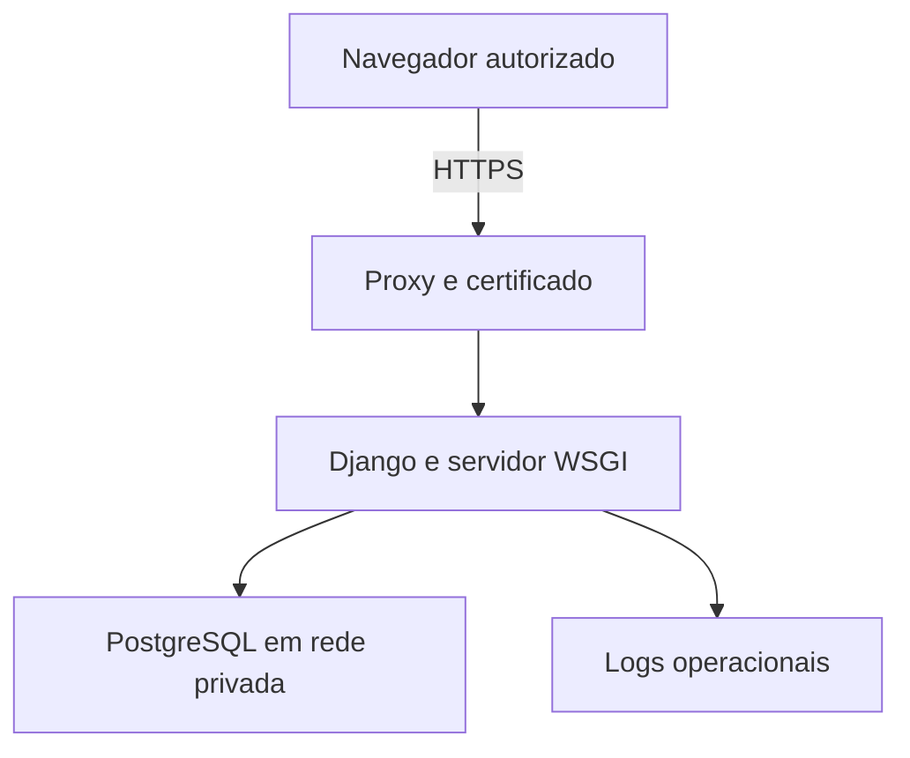

# Plano de deploy do OP-APP — issue #16

Data: 17/11/2026. Referência revisada: `main`, commit `68bd91e9ef2e2803b050e176c9b5e83bb07fff15`.

**Situação:** MVP funcional validado localmente; preparação de implantação ainda pendente. Este documento é um plano, sem provisionamento, alteração de DNS, publicação, cópia de dados ou liberação de piloto.

Manex pediu primeiro o diagnóstico e o plano. O endereço será um subdomínio de **manexlabs.dev**; o nome exato e a infraestrutura ainda não foram escolhidos. Não assumir contratação de serviço ou uso da VPS existente.

## 1. O que já está pronto

| Área | Evidência atual |
| --- | --- |
| Aplicação | Django 5.2, Python 3.12 de referência, PostgreSQL 17 e interface Django Admin/Templates |
| Organização | Setores, funções e trabalhadores, com normalização, inativação e integridade |
| Operação | Tarefas com ciclo de vida e histórico; alocações individuais/multidiárias; quadro semanal |
| Autorização | Administrador operacional global; Coordenador, Líder e Consulta com escopo por setor; gestão de acesso exclusiva do superusuário |
| Validação | Issue #6 concluída por aceite combinado de navegador e testes; 118 testes aprovados, incluindo HTTP real com login, sessão e CSRF |
| CI | Instala dependências fixadas, valida Compose, sobe PostgreSQL 17, aplica/confere migrações e executa testes; não publica aplicação |
| Segredos e segurança básica | `.env` ignorado, exemplo sem senhas, chave vazia rejeitada, flags explícitas para HTTPS/cookies, escopo e autoria no backend |
| Base para hospedagem | `config/wsgi.py` disponível; banco local em Compose com persistência e healthcheck |

Evidências: [aceitação de 16/11](aceitacao-local-2026-11-16.md), [complemento e aceite de 17/11](aceitacao-local-2026-11-17.md), [CI aprovado](https://github.com/AldomarAssolin/op-app-industrial/actions/runs/44182988282) e [PR #15 incorporada](https://github.com/AldomarAssolin/op-app-industrial/pull/15).

Essas evidências validam o comportamento local. Não comprovam capacidade do servidor, DNS, certificado, proxy, recuperação do banco real ou disponibilidade externa.

## 2. O que falta para deploy

| Área | Estado observado no repositório | Trabalho necessário |
| --- | --- | --- |
| Destino | Nenhuma hospedagem configurada para este projeto | Escolher serviço/servidor, verificar recursos, acesso, custos e isolamento |
| Domínio | Família `manexlabs.dev` escolhida; sem subdomínio exato aprovado | Escolher nome, definir DNS e validar TLS/renovação |
| Processo web | Desenvolvimento por `runserver`; nenhum servidor WSGI no manifesto | Definir servidor de aplicação, comando, reinício e encerramento; Gunicorn é uma opção proposta |
| Empacotamento | Sem Dockerfile da aplicação; Compose contém somente banco de desenvolvimento | Se adotar contêiner, criar imagem reproduzível, usuário sem privilégios, exclusões de build e configuração do serviço |
| Estáticos | Apenas `STATIC_URL`; sem `STATIC_ROOT` nem entrega de estáticos definida | Configurar coleta e serviço dos CSS/JS do Admin com DEBUG=False |
| Configuração | Exemplo orientado a desenvolvimento; flags de HTTPS existem | Preparar configuração do destino, hosts restritos, segredos próprios, proxy e origens CSRF quando necessárias |
| Banco | Compose local publica 127.0.0.1:5433 | Criar banco/volume próprios no destino, acesso interno e credenciais distintas; conta da aplicação sem poderes administrativos globais |
| Entrega | CI de testes; sem procedimento de release | Definir build, migrações controladas, sincronização de perfis, versão e retorno à versão anterior |
| Saúde e operação | Sem endpoint de saúde ou configuração operacional de logs | Definir verificação de processo/banco, logs sem segredos, retenção e aviso de falhas |
| Recuperação | Sem rotina implementada de backup/restauração | Definir cópias protegidas fora do servidor, frequência, retenção e ensaio em banco separado |
| Contas e dados | Dados QA e contas de teste permanecem no ambiente local anterior | Inventariar o que entrará no piloto; criar contas nominativas e revisar grupos/vínculos; nenhuma importação ou exclusão automática |

## 3. Arquitetura proposta para avaliação

Manter Django/Templates e PostgreSQL. Para um primeiro piloto, não há requisito demonstrado para adicionar React, API pública, Redis, Celery ou Kubernetes.

Os estáticos serão servidos pela solução escolhida na etapa de empacotamento, sem depender de DEBUG=True. Somente a entrada HTTPS fica pública; o banco e a porta interna da aplicação não devem ser publicados para a Internet.

**Opção a avaliar:** contêiner Django com Gunicorn e PostgreSQL separado. Isso favorece repetição do build e pode aproveitar uma plataforma de contêineres. Exige preparar imagem, rede, volumes, recursos e operação. Se o provedor oferecer execução Python gerenciada, adaptar a entrega sem criar uma segunda infraestrutura desnecessária. A escolha de VPS/EasyPanel ainda não está aprovada.

## 4. Decisões antes de implementar

| Decisão | Situação / critério |
| --- | --- |
| Hospedagem | Pendente; comparar capacidade, custo, manutenção, acesso e backup. Se reutilizar VPS, medir a carga atual antes de acrescentar serviços |
| Nome do host | Pendente; será subdomínio de manexlabs.dev, sem DNS criado por este plano |
| Primeiro conteúdo | Proposta: iniciar piloto externo com dados sintéticos; dados reais exigem autorização separada |
| Responsáveis | Nomear responsável por ambiente, suporte, atualizações e recuperação; não presumir disponibilidade permanente de uma pessoa |
| Perda tolerável de dados | Definir RPO: quanto planejamento pode ser perdido; usar isso para escolher frequência das cópias |
| Tempo de recuperação | Definir RTO: quanto tempo o sistema pode ficar indisponível; medir esse prazo no ensaio |
| Contas e acesso | Definir participantes, setores e superusuário de configuração; decidir inventário e desativação dos usuários QA |
| Janela e reversão | Combinar horário de mudanças e procedimento de retorno, inclusive compatibilidade entre código e esquema do banco |

## 5. Sequência de execução

| Etapa | Entrega concreta | Evidência para avançar |
| --- | --- | --- |
| 1. Definir destino | Host exato, plataforma, responsáveis, capacidade e estratégia de dados | Decisões registradas; nenhuma publicação implícita |
| 2. Preparar aplicação | Servidor WSGI, estáticos, configuração de deploy e empacotamento adequado | Build reproduzível; aplicação inicia com DEBUG=False; CSS/JS do Admin carregam; suíte e CI passam |
| 3. Ensaiar release | Procedimento de migração, configuração de perfis, healthcheck e versão | Subida em ambiente descartável, reinício e falha controlada observados; rollback documentado |
| 4. Preparar recuperação | Backup, armazenamento protegido, retenção e procedimento de restauração | Restaurar uma cópia em outro banco; conferir usuários/grupos/vínculos, tarefas/histórico e alocações; registrar tempos |
| 5. Implantar piloto sintético | Banco e segredos próprios, DNS, certificado, proxy e logs | Host HTTPS acessível, banco não público e ausência de loops/redirecionamentos incorretos |
| 6. Aceitar ambiente real | Conferir segurança, papéis, estáticos, sessão e recuperação no destino | Matriz abaixo aprovada no host efetivo; revisão das contas e dos dados |
| 7. Encerrar #16 | Relatório da versão publicada e aceite operacional | Todos os gates da issue atendidos; responsáveis e autorização de dados registrados |

Essas etapas podem virar PRs pequenas de configuração, operação e evidências. Uma PR de plano não equivale à conclusão das etapas.

## 6. Segurança, dados e recuperação

Configurar DEBUG=False e ALLOWED_HOSTS restrito ao host aprovado; manter chaves e senhas fora do Git, diferentes do desenvolvimento. Habilitar cookies Secure e redirecionamento HTTPS depois de validar a terminação TLS. Avaliar HSTS de forma gradual, sem aplicar preload/includeSubDomains indiscriminadamente ao domínio.

Não basta copiar `SECURE_PROXY_SSL_HEADER`: é preciso saber quem termina TLS, impedir acesso direto ao backend e garantir que o proxy remova ou substitua o cabeçalho recebido do cliente. Configurar origens CSRF somente quando a arquitetura exigir, com valores exatos; não ampliar origens para contornar erro de login.

Backup deve incluir o banco e um procedimento separado para recuperar configuração/segredos e recriar permissões necessárias. Volume persistente não substitui backup. Escolher frequência, retenção, criptografia, destino externo ao servidor e teste periódico. `pg_dump` e `pg_restore` são candidatos para cópia lógica; o procedimento final precisa identificar origem e destino explicitamente e nunca restaurar sobre a origem como teste. Dumps podem conter dados pessoais e credenciais armazenadas: não anexar ao GitHub.

Restaurar em banco separado e conferir conteúdo e acesso, não apenas a existência do arquivo ou o sucesso do comando. Testar login com conta apropriada, totais e vínculos, histórico, alocações e migrações. Um ensaio descartável inicial não comprova a recuperação do banco efetivo do piloto.

Recomenda-se banco novo com dados sintéticos na primeira publicação. Se houver necessidade de importar o banco local, revisar e autorizar dados, contas, grupos, vínculos, sessões e registros QA antes; não copiar tudo por conveniência. Não apagar dados de teste sem inventário e procedimento aprovado.

## 7. Matriz de aceitação no host efetivo

| Verificação | Resultado necessário |
| --- | --- |
| HTTPS e certificado | Certificado válido; HTTP direciona ao HTTPS sem loops; renovação prevista |
| Host e proxy | Host permitido; host indevido rejeitado; cabeçalhos encaminhados não podem ser falsificados externamente |
| Estáticos | CSS/JS do Admin carregam com DEBUG=False |
| Autenticação | Login/logout funcionam; sessão encerrada não recupera acesso; cookies com atributos esperados |
| CSRF | Formulário legítimo funciona e POST sem token é rejeitado |
| Papéis e setores | Consulta sem escrita; Líder/Coordenador restritos; Administrador operacional sem gestão de acessos |
| Integridade | Duplicidade, inativação, tarefa encerrada e período inválido rejeitados sem gravação parcial |
| Verificação Django | `check --deploy` executado com as configurações reais; avisos resolvidos ou justificados explicitamente |
| Banco e segredos | Banco sem exposição pública; segredos não aparecem em repositório, build, logs ou páginas de erro |
| Recuperação | Backup do banco efetivo restaurado em outro banco, conferido e cronometrado |
| Operação | Responsável, suporte, retenção, versão, logs, monitoramento e rollback registrados |

Usar como entradas `/admin/` e `/planejamento/semanal/`. A rota `/` hoje não existe; não usar seu 404 como diagnóstico de aplicação caída. Definir uma rota de saúde própria ou outra verificação adequada na implementação.

## 8. Critério de encerramento e próxima entrega

A [issue #16](https://github.com/AldomarAssolin/op-app-industrial/issues/16) fica aberta. Para encerrá-la, registrar host exato, infraestrutura, commit/imagem implantados, data, responsáveis, evidências da matriz, recuperação e aprovação do uso dos dados. Não marcar itens do ambiente real como concluídos por testes locais.

**Próxima entrega recomendada:** escolher hospedagem e subdomínio exato; depois preparar a aplicação para execução com DEBUG=False (servidor WSGI, estáticos e configuração). DNS e publicação vêm após esse pacote funcionar em ensaio.

## Fontes técnicas

Consultadas em 17/11/2026; orientar a implementação sem substituir os testes do ambiente real:

- [Django 5.2 — Deployment checklist](https://docs.djangoproject.com/en/5.2/howto/deployment/checklist/).
- [Django 5.2 — Gunicorn](https://docs.djangoproject.com/en/5.2/howto/deployment/wsgi/gunicorn/).
- [Django 5.2 — Estáticos em deploy](https://docs.djangoproject.com/en/5.2/howto/static-files/deployment/).
- [Django 5.2 — SECURE_PROXY_SSL_HEADER](https://docs.djangoproject.com/en/5.2/ref/settings/#secure-proxy-ssl-header).
- [PostgreSQL 17 — SQL Dump e restauração](https://www.postgresql.org/docs/17/backup-dump.html).
